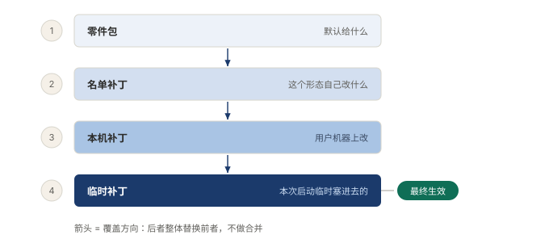
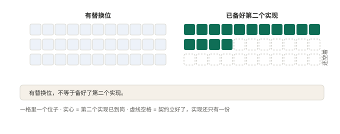

# §06 同一套东西，为什么能装出四种形态

同一家公司，周一全员到岗，周三只来三个人，月底还跟了一队实习生。楼是同一栋，人是同一批。

这套人马也一样。同一套东西，装出四种形态，差别只有一条：今天雇了哪些临时工。

这一节讲装的三样东西：规矩怎么叠，编制怎么配，哪些位子备了替补。

## 6.1 小白版：规矩叠三层，编制有四套

公司里的规矩是三层叠着来的。

公司定一份大规矩：几点上班，假怎么请。部门再定一份小的：这个组周五不打卡。工位上还能贴张纸条：这星期先走一步。三层撞了听谁的？听最小的。纸条压过部门，部门压过公司。不是纸条官大，是它最晚贴、离人最近。大规矩是兜底，兜不住的才轮到纸条。

**图 10：规矩三层叠着来，小的压大的**〔本书〕

越晚贴上的越说了算，顺序就是优先级。层数低不等于权力大，这条最容易记反。同一句话被写了三遍，作数的只有最晚那一遍。

规矩定了怎么干活，编制定今天来多少人。四套编制：满编，什么都带；带徒弟，老师傅干活，边上跟个学的；轻装，只带最要紧的几样；招新，摊子铺开，专门迎接刚入行的。

四套编制不是四家公司。楼是同一栋，脑子是同一颗，差别只在排班表上勾了哪些临时工。满编勾得最多，轻装勾得最少。

**图 11：四套编制共用一块薄底板，差别只在多雇了谁**〔本书〕

公用的底板比想象中薄。凡是各编制不一样的东西，都不写进底板，推到各编制自己的纸上。底板越薄，换编制越像换一张纸，不是翻修一栋楼。也有不合群的：有一份编制干脆不踩底板，自己从头到尾写全。它不是叛逆，是另一份并列的排班表。

第三样：哪些位子能换人。

不是每个位子都有替补。有的位子上贴着「可替换」，还真备着第二个人选。有的位子也是临时工，可全公司就他一个会干，他请假就停摆。位子是当初特意留的，替补是后来慢慢补的。这是两笔账，别算成一笔。

## 6.2 专业版：三个角色、一条顺序、四种 preset

装配的正式说法是三个角色，各管一段，互不重叠。

| 角色 | 它是什么 | 它说了算什么 |
|---|---|---|
| profile | 一份名单 | 装什么 |
| bundle | 可分发的零件包 | 默认值 |
| patch | 按名字定位的修改条 | 最终值 |

三者不能合成一个：名单回答装什么，零件包回答默认给什么，修改条回答最终是什么。混在一起，形态就没法只换一层。

叠放的顺序，一句话说得完：

> 各层按此顺序应用在空条目列表之上：先按 profile 列出的顺序应用每个组合包，然后是 profile 的补丁文件，然后是 home 级的那份。

从空名单起叠，同一行被写下好几次，生效的只有最晚那次。修改条命中后交出的是一整块配置，系统整块替换目标行，不做逐字段合并。不做合并的理由是歧义：数组算追加还是替换、嵌套算到第几层，每条都得单独定规则，规则一多，结果没人敢保证。宁可让人多抄几行，换任何一行只有一个出处，整棵树能原样打印。

四种 preset 形态：标准、PTC、极简、创造。它们是四份并列名单，多数以同一块共享底座开头，再加一层薄清单，只回答「我哪里跟别人不一样」。有一份不套底座，自己就是完整的一棵树。机制里没有父子名单这个概念，形态之间并列，不记继承。

「能换的位子」的正式名字叫 seam，接缝。官方把服务分了几类：

> 服务可以是核心主干服务、可替换的能力 seam、组合包／组合点或独立服务。

**图 12：备了替补的位子，不等于替补已到岗**〔本书〕

结构账和库存账是两笔账。留替换位，改的是消费方那一侧，让它们只认名字不认实现，这笔钱立契约时就付了。补第二个实现是另一笔，可以晚付，也可以别人付。空着的位子不算欠债，最贵的那笔已经付掉：消费方不再依赖具体实现。库存会动，结构不动。

这套装法的代价也摆在那：修改条必须写全，啰嗦但确定；读一遍名单看不出系统在干什么，行为得从配置里重建。省事和确定只能选一个，这里选了确定。

回到标题的问题。四种形态不是四个产品，是同一套东西按四张名单装出来的，差别只有装了哪些插件。

## 6.3 两种说法的对照

| 小白说法 | 专业术语 |
|---|---|
| 公司大规矩、部门规矩、工位纸条 | 三层覆盖（零件包默认值、名单补丁、用户级修改），小的压大的 |
| 四套编制（满编、带徒弟、轻装、招新） | 四种 preset 形态（标准、PTC、极简、创造） |
| 排班表上勾了谁 | profile 名单 |
| 零件包 | bundle |
| 修改条 | patch |
| 备了替补的位子 | 接缝（seam） |
| 位子上现在站着几个人 | 第二个实现是否到位（库存账） |

## 6.4 最容易理解错的地方

第一处：以为层数低权力大。正好相反，顺序就是优先级，越晚落下越说了算，低层只是兜底。

第二处：以为四种形态有父子关系，都从一个总形态继承。四份名单并列，不记父子；共用底板只是多数人的选择，有一份压根不踩底板。

第三处：把「一切皆插件」理解成什么都能换。装法统一，换法不统一。有替换位不等于备好了第二个实现，结构账和库存账得分开算。

## 6.5 这条能搬去哪

第一，看自己的配置系统：最终生效的那一份，能不能一条命令原样打印出来？打不出来，说明合并规则藏在实现里，打印出来的不是真相。

第二，判断一个服务能不能换，数它名下挂了几个平级实现，再看消费方代码里有没有出现实现的名字。两个问题答完，这个位子的替换半径就清楚了。

<!-- FIGURES
图 10 fig-3-2-config-overlay 〔本书〕
图 11 fig-10-3-base-vs-modes 〔本书〕
图 12 fig-15-3-seam-second-impl 〔本书〕
-->
