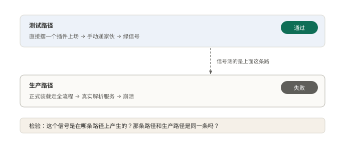

# §15 它出过什么事：四个真实案例

上一节末了那句「不担保不出事」，这一节兑现。

四起事故有个共同点：出事那会儿，各处的信号全是绿的。没有一起是误报，全是漏报。

入选复盘还有三条门槛。一是根因隐蔽。二是漏子出在流程上，不是某一次手滑。三是重新发现的代价高。四起都过了这三关。

但最重的一次不是事故，是围墙本身被人穿过去了。放在最前面讲。

## 15.1 小白版：把门的出事，四种方式

先说围墙上那件事。小区有扇后门，进门不用钥匙，只看访客自己举的姓名牌。牌子上写「我是本小区的」，门就开。门房的本子上甚至写着一行小字：这牌子不算凭证。

结果有人举着假牌子进了门。进去之后，他给自己印了一张最高通行证。他还替业主把该签的字全签了。事后评危险程度，快顶到满分。门已经换锁。

物业其实早说过：围墙不保证挡人。这件事不过是把那句话演示了一遍。

再说四起事故，四种出法。

第一种，喜报是假的。彩排次次成功，正式上场头一天就砸。彩排走的后门，上场走的正门，两扇门不一样。后门那条路，永远照不出正门才会出的问题。

第二种，验收单是真的，铺子是空的。验收的人看见门面亮着灯，就写了合格。灯是隔壁铺子的灯。

第三种，凭一个记号定罪。两个人的制服前两个字相同。贴通知的和闯大祸的，被当成了同一个。罚错了人。

第四种，记录全在，没人查。出了事，全靠当事人回忆怎么出的。其实本子上每一步都记着。照着本子，就能把那天重演一遍。不用问任何人。

**图 33：四张喜报全是绿的，对应的真实状态全错**〔本书〕

左边一列是看起来对的，右边一列是实际发生的。四行一一配对，没有一行对得上。绿不等于对，只看它绿在哪条路上。

## 15.2 专业版：每个案例三步走

漏洞先讲。本地那个网页接口没有认证，只校验了对方自报的 Host 头。代码注释里自己写着：「这不是认证层」。

沙箱里的 agent 能给自己提权到最高权限，并绕过人工审批。评分 CVSS 9.4。出事的原因在身份判断。它被交给一个客户端可以自报的头。这道校验，又被当成了认证。

设计因此改了什么：已在 v0.1.2-alpha.1 修复。但更准确的说法是，设计早就把话说在前头。沙箱「不保证隔离，也不防止破坏」。这个漏洞就是那句话的注脚。

事故一：一个服务器一连接就崩，带着全套绿色测试。原因在测试那边。插件是手拼的一个对象。生产走的是真实加载与解析那条路。信号产自另一条路。

> 所有测试都通过一条不会触及插件真实加载方式和服务真实解析方式的路径来挂载插件。

改了什么：测试改走生产那条装配路径。覆盖率不是坏指标，是被放错了地方。它量的是执行过的行，不是交付出去的行为。

事故二：一整套能力被永久关掉，快照套件一直是过的。病因和事故一相同。信号绿在了一条不经过真实装配的路上。改了什么：同一份修法，对齐路径。

事故三。一个网页应用被验收通过，返回的确实是成功状态码。页面其实一片空白。

原因有两个。状态码来自一个裸的静态服务。引导标记只由完整宿主注入，缺了它页面就是空的。它还去验收了另一个端口上的服务。证据来自旁边那一次运行。

一处就绪，不等于整体就绪。信号脱开产生它的上下文，就会骗人。它不说谎，只是不属于这里。

事故四。一个子程序被判成沙箱故障。约束其实成功了，执行也成功了。

原因在归因规则。一条无害通知和一次致命失败共用同一个前缀。配上任意非零退出码，全被算成沙箱故障。

改动有两处。先精确排除信息性的那一行。再由退出状态门控致命证据。两条同时成立，才算数。共享前缀不是协议，进程归因需要多项独立证据同时成立。

复盘的纪律也跟着定了。事实底座是带序号的事件日志，不是事后自述。

> 下方时间线以这些事件为依据，而不是根据后续报告反推意图。

自述反推意图，日志能回放，两者不是一类东西。事故三能定位到出错的那一步，靠的就是这份日志。这也是复盘定位的兑现：

> 事故复盘记录的是：一个 bug 出现在了不该出现的地方……值得关注的是为什么我们的流程放过了它，而不仅仅是那一行修复。

**图 34：信号产自哪条路，就只能证明哪条路**〔本书〕

上面是测试路径，直接拼对象，信号是绿的；下面是生产路径，走真实加载与解析，结果是崩的。测试替身本来是为了跑得快。它替掉的，恰恰是装配那一段。而装配正是插件系统最容易出错的地方。速度换来一段没人看管的空白。

**图 35：复盘的事实底座是日志，不是自述**〔本书〕

左边是事后自述，画成虚线；右边是带序号的事件日志。复盘只从右边取事实。日志当时写下的顺序，就是复盘时的顺序。这是前面「单一事实源」那节结论的一次兑现。

## 15.3 两种说法的对照

| 小白说法 | 专业术语 |
|---|---|
| 姓名牌 | Host 头校验 |
| 最高通行证 | 提权到最高权限 |
| 替业主签字 | 绕过人工审批 |
| 彩排走的后门 | 测试替身路径 |
| 门面亮灯就算开业 | 传输层就绪误当应用就绪 |
| 凭一个记号定罪 | 单信号归因 |
| 本子 | 事件日志 |

## 15.4 最容易理解错的地方

第一处：以为绿灯亮着就没事。四起事故全是漏报，没有一起误报。信号的意义由它产生的路径决定。

第二处：以为复盘是找出那行错代码。复盘问的是流程为什么放过了它。修一行是治标，流程漏的那一格才是本。

第三处：以为沙箱逃逸说明设计撒了谎。恰好相反，设计早把「不保证」写在了明处。漏洞不是打脸，是注脚。

第四处：以为一条证据就能归因。共享前缀不是协议。拿一个便宜的信号去顶一个贵的判断，是这类坑的共同形状。

## 15.5 这条能搬去哪

四个自查动作。第一，挑一条最绿的测试。问它挂依赖的方式，和生产是不是同一条。第二，挑一次线上问题，看能不能只靠日志还原，不问当事人。

第三，挑一条归因规则，数一数它同时要求几项证据。第四，找出自己系统的「不保证」清单写在哪。没有，就补上。

四条里没有一条是让人多写测试。换的是问法：从信号够不够绿，换成它绿在哪条路上。

为什么这么设计？边界上的判断，全建立在信号之上。信号脱了上下文，边界就成了摆设。能搬去哪？任何靠自动化信号守门的流程：先对齐路径，再看数值。

<!-- FIGURES
图 33 fig-17-1-four-signals 〔本书〕
图 34 fig-17-2-signal-path 〔本书〕
图 35 fig-17-3-log-is-evidence 〔本书〕
-->
